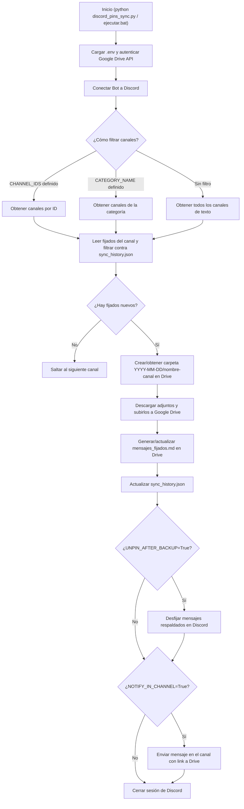

# 📌 Discord Pins to Google Drive Backup Bot

Script automatizado en **Python** que extrae los mensajes fijados (*pinned messages*) de canales de un servidor de **Discord** —incluyendo texto, *embeds*, imágenes, videos y audios— y los respalda de forma estructurada en **Google Drive**.

---

## 💡 Motivación

Discord impone un límite estricto de **50 mensajes fijados por canal**. En comunidades activas, esto suele obligar a crear nuevos canales ("general-2", "general-3") y mover los antiguos a una sección de archivo/histórico.

Este bot soluciona el problema permitiendo:
1. **Resguardar todos los mensajes fijados y sus archivos multimedia** en Google Drive organizados por fecha de ejecución y canal.
2. **Desfijar automáticamente** (opcional) los mensajes ya respaldados para liberar el límite de 50 fijados sin tener que crear canales nuevos.
3. **Notificar en el canal de Discord** con el enlace directo a la carpeta de Google Drive donde quedó guardado el respaldo.

---

## ✨ Características Principales

- **Tres modos de selección de canales**:
  - Por lista de **IDs de canales específicos** (`CHANNEL_IDS`).
  - Por **categoría** de Discord (`CATEGORY_NAME`, ej. `historico`).
  - **Todos los canales** de texto del servidor.
- **Descarga multimedia completa**: Resguarda imágenes, videos, audios y cualquier archivo adjunto conservando el ID del mensaje original.
- **Resumen en Markdown (`mensajes_fijados.md`)**: Genera un documento legible en cada carpeta con autor, fecha/hora UTC, texto del mensaje, contenido de *embeds* y enlaces directos a cada archivo subido en Drive.
- **Organización por fecha de ejecución**: Agrupa los respaldos bajo carpetas `YYYY-MM-DD/<nombre-del-canal>`.
- **Desfijado automático opcional (`UNPIN_AFTER_BACKUP`)**: Limpia los fijados del canal una vez asegurados en Google Drive.
- **Aviso automático en Discord (`NOTIFY_IN_CHANNEL`)**: Publica un mensaje en el canal procesado con el link a la carpeta de Drive.
- **Control de duplicados (`sync_history.json`)**: Registra localmente qué mensajes ya fueron respaldados para no volver a subirlos en ejecuciones futuras.
- **Soporte para Unidades Compartidas (*Shared Drives*)**: Compatible tanto con carpetas en "Mi Unidad" como en Unidades Compartidas de Google Workspace.
- **Modo simulación (`DRY_RUN`)**: Permite verificar qué canales y mensajes se procesarían sin subir archivos ni modificar nada en Discord.
- **Ejecución en 1 clic para Windows (`ejecutar.bat`)**: Incluye validaciones previas de entorno y credenciales.

---

## 🔄 Flujo de Funcionamiento



---

## 📁 Estructura del Repositorio

```text
discord-pins-gdrive/
├── discord_pins_sync.py   # Script principal de sincronización
├── ejecutar.bat           # Lanzador rápido para Windows (doble clic)
├── requirements.txt       # Dependencias de Python
├── .env.example           # Plantilla de variables de entorno
├── .gitignore             # Protección para no subir claves ni temporales a Git
└── README.md              # Documentación del proyecto
```

*(Archivos generados o locales ignorados por Git: `.env`, `credentials.json`, `sync_history.json`, `temp_downloads/`).*

---

## 🛠️ Requisitos Previos

- **Python 3.10 o superior** (compatible con Python 3.13 / 3.14+).
- Una aplicación/bot en el **Discord Developer Portal**.
- Un proyecto en **Google Cloud Console** con **Google Drive API** habilitada y una **Cuenta de Servicio (Service Account)**.

### 1. Configurar el Bot de Discord

1. Ingresa al [Discord Developer Portal](https://discord.com/developers/applications) y haz clic en **New Application**.
2. En el menú izquierdo, entra en **Bot**:
   - Copia el **Token** del bot (haz clic en *Reset Token* si no aparece). Lo usarás en `DISCORD_TOKEN`.
   - Baja hasta **Privileged Gateway Intents** y activa:
     - ✅ **Server Members Intent**
     - ✅ **Message Content Intent** *(Obligatorio para leer el texto y adjuntos de los fijados)*.
   - Guarda los cambios.
3. Ve a **OAuth2 -> URL Generator**:
   - En **Scopes**, marca: `bot`.
   - En **Bot Permissions**, marca:
     - `Read Messages/View Channels` (Ver canales)
     - `Read Message History` (Leer el historial de mensajes)
     - `Send Messages` *(Necesario si activas `NOTIFY_IN_CHANNEL=True`)*
     - `Manage Messages` *(Necesario si activas `UNPIN_AFTER_BACKUP=True` para desfijar mensajes)*
4. Copia la URL generada al final de la página, ábrela en tu navegador e invita al bot a tu servidor.

> 💡 **¿Cómo obtener el ID de tu servidor (`GUILD_ID`) y de tus canales (`CHANNEL_IDS`)?**
> En Discord, ve a *Ajustes de usuario -> Avanzado* y activa el **Modo desarrollador**. Luego haz clic derecho sobre el ícono de tu servidor o sobre cualquier canal y selecciona **Copiar ID**.

### 2. Configurar Google Drive (Cuenta de Servicio)

1. Entra a [Google Cloud Console](https://console.cloud.google.com/) y crea o selecciona un proyecto.
2. En el buscador superior, busca **Google Drive API** y haz clic en **Enable (Habilitar)**.
3. Ve a **APIs & Services -> Credentials** -> **+ Create Credentials** -> **Service Account**.
4. Asígnale un nombre, finaliza la creación y entra al detalle de la cuenta de servicio recién creada.
5. En la pestaña **Keys**, selecciona **Add Key -> Create new key -> JSON**. Se descargará un archivo `.json`.
6. Renombra ese archivo a `credentials.json` y colócalo en la raíz de este proyecto.
7. Copia el email de la cuenta de servicio (campo `"client_email"` dentro de `credentials.json`, con formato `nombre@proyecto.iam.gserviceaccount.com`).
8. En **Google Drive**, crea o abre la carpeta donde guardarás los respaldos y **compártela** con ese `client_email` dándole permisos de **Editor** (o **Administrador de contenido / Content manager** si usas una Unidad Compartida).
9. Copia el ID de la carpeta desde la URL de tu navegador:
   `https://drive.google.com/drive/folders/ESTE_ES_EL_ID`

---

## 🚀 Instalación y Configuración

### 1. Clonar el repositorio e instalar dependencias

```bash
git clone https://github.com/TU_USUARIO/TU_REPOSITORIO.git
cd TU_REPOSITORIO
python -m pip install -r requirements.txt
```

### 2. Configurar el archivo `.env`

Copia el archivo de ejemplo `.env.example` a `.env`:

```bash
cp .env.example .env
```

Edita `.env` con tus datos:

```env
DISCORD_TOKEN=tu_discord_bot_token_aqui
GUILD_ID=123456789012345678
DRIVE_FOLDER_ID=1a2b3c4d5e6f7g8h9i0j

# Selección de canales (CHANNEL_IDS tiene prioridad sobre CATEGORY_NAME)
CHANNEL_IDS=977722759398428692,1234567890123456789
CATEGORY_NAME=historico

SERVICE_ACCOUNT_FILE=credentials.json
UNPIN_AFTER_BACKUP=False
NOTIFY_IN_CHANNEL=True
DRY_RUN=False
```

#### Tabla de Variables de Entorno

| Variable | Obligatorio | Valor por defecto | Descripción |
| :--- | :---: | :---: | :--- |
| `DISCORD_TOKEN` | Sí | — | Token secreto de tu bot de Discord. |
| `GUILD_ID` | Sí | — | ID numérico del servidor (Guild) de Discord. |
| `DRIVE_FOLDER_ID` | Sí | — | ID de la carpeta raíz en Google Drive donde se guardarán los respaldos. |
| `CHANNEL_IDS` | No | Vacío | IDs de canales específicos separados por coma (ej. `111,222`). Si se define, ignora `CATEGORY_NAME`. |
| `CATEGORY_NAME` | No | `historico` | Nombre de la categoría de Discord cuyos canales se procesarán si `CHANNEL_IDS` está vacío. |
| `SERVICE_ACCOUNT_FILE` | No | `credentials.json` | Ruta al archivo JSON de credenciales de la Service Account de Google. |
| `UNPIN_AFTER_BACKUP` | No | `False` | Si es `True`, desfija los mensajes del canal en Discord tras respaldarlos en Drive. |
| `NOTIFY_IN_CHANNEL` | No | `True` | Si es `True`, el bot envía un mensaje en el canal con el link a la carpeta de Google Drive. |
| `DRY_RUN` | No | `False` | Si es `True`, ejecuta una simulación en consola sin subir archivos ni modificar fijados. |

---

## ▶️ Ejecución

### En Windows (1 clic)
Haz doble clic sobre **`ejecutar.bat`**. El script verificará que Python, `.env` y `credentials.json` estén presentes y ejecutará la sincronización mostrando el progreso en pantalla.

### Desde la terminal (Windows / Linux / macOS)
```bash
python discord_pins_sync.py
```

---

## 📂 Estructura Generada en Google Drive

En cada ejecución donde existan fijados nuevos, el bot organiza los archivos por fecha (`YYYY-MM-DD`) y por nombre de canal:

```text
📁 Carpeta Raíz (DRIVE_FOLDER_ID)
 └── 📁 2026-05-23
      ├── 📁 general
      │    ├── 📄 mensajes_fijados.md
      │    ├── 🖼️ 1507842617390665882_Doom-Jolly-Hat.jpg
      │    └── 🎥 1507842661636112494_m2-res_1080p.mp4
      └── 📁 clips-y-audios
           ├── 📄 mensajes_fijados.md
           └── 🎵 1507842999999999999_nota_de_voz.ogg
```

Y en el canal de Discord procesado, el bot publicará:
> 📦 **4 mensaje(s) fijado(s) resguardados exitosamente.**
> 📂 Carpeta en Google Drive: `https://drive.google.com/drive/folders/...`

---

## 🔒 Seguridad

- El archivo [`.gitignore`](.gitignore) está configurado para **excluir automáticamente** `.env`, `credentials.json`, `sync_history.json` y `temp_downloads/`.
- **Nunca** compartas ni subas tu `DISCORD_TOKEN` ni tu archivo `credentials.json` a repositorios públicos. Si alguna clave se expone accidentalmente, rótala de inmediato desde el Discord Developer Portal o Google Cloud Console.
